<div align="center">

<a href="https://github.com/ohimeee/Kizuna-Desktop">
    
</a>

# Kizuna Desktop

### Your light novels and manga, on a real reader for Windows.

Free and open source. No ads, no account. The Windows companion to [Kizuna](https://github.com/ohimeee/Kizuna) for Android.

<a href="https://github.com/ohimeee/Kizuna-Desktop/releases/latest"></a>

[](https://github.com/ohimeee/Kizuna-Desktop/releases/latest)
[](https://github.com/ohimeee/Kizuna-Desktop/releases)
[](/LICENSE)
[](https://github.com/ohimeee/Kizuna-Desktop/releases/latest)

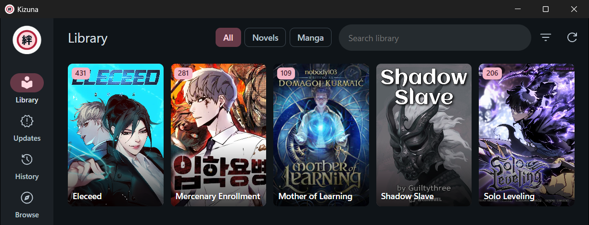

<table>
  <tr>
    <td align="center" width="25%">
      
      <h1>5 MB</h1>
      <b>Tiny download</b><br>
      <sub>the whole app, and it updates itself</sub>
    </td>
    <td align="center" width="25%">
      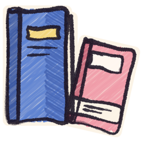
      <h1>2 in 1</h1>
      <b>Novels and manga</b><br>
      <sub>one library, one app</sub>
    </td>
    <td align="center" width="25%">
      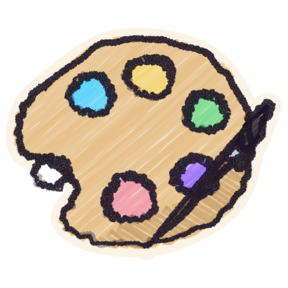
      <h1>15</h1>
      <b>Themes</b><br>
      <sub>each in light, dark and pure black</sub>
    </td>
    <td align="center" width="25%">
      
      <h1>100%</h1>
      <b>Free</b><br>
      <sub>no ads, no account, ever</sub>
    </td>
  </tr>
</table>

**[Download](#download)** · **[Screenshots](#screenshots)** · **[Features](#features)** · **[Coming from the phone app?](#coming-from-kizuna-on-android)** · **[Build from source](#building-from-source)**

</div>

## Why Kizuna Desktop?

**Light on your PC. Easy on your eyes. Your phone library comes along.**

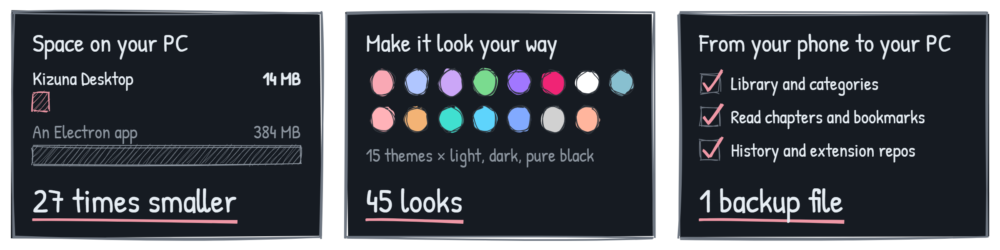

<sub>Installed size measured on the same Windows 11 PC: Kizuna Desktop 0.4.0 against Obsidian 1.15, a popular app built on Electron.</sub>

<div align="left">

* **A reader made for long sessions.** The novel reader is a port of Kizuna's Android reader, with the
  same paragraph handling, title styling and reading themes, plus a column width that makes sense on a
  wide monitor.
* **Novels and manga together.** Add the novel sources you already know, plus manga from the Mihon
  extension repos you already use, and keep everything in one library with categories and unread badges.
* **Picks up where your phone left off.** Import a backup from Kizuna on Android to bring over your
  library, categories, read chapters and history in one step.
* **Light and quick.** About 5 MB to install, no admin rights needed, and the app updates itself.

</div>

## Screenshots

<table>
  <tr>
    <td width="50%">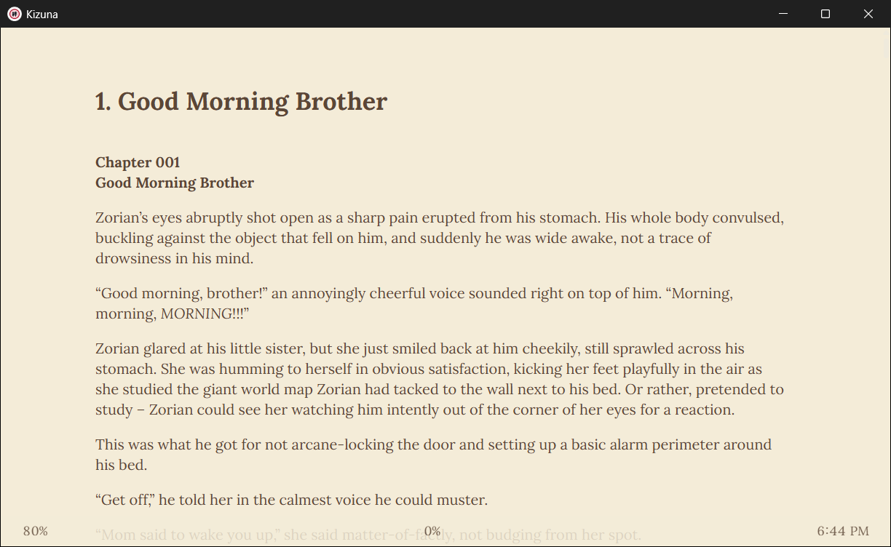</td>
    <td width="50%">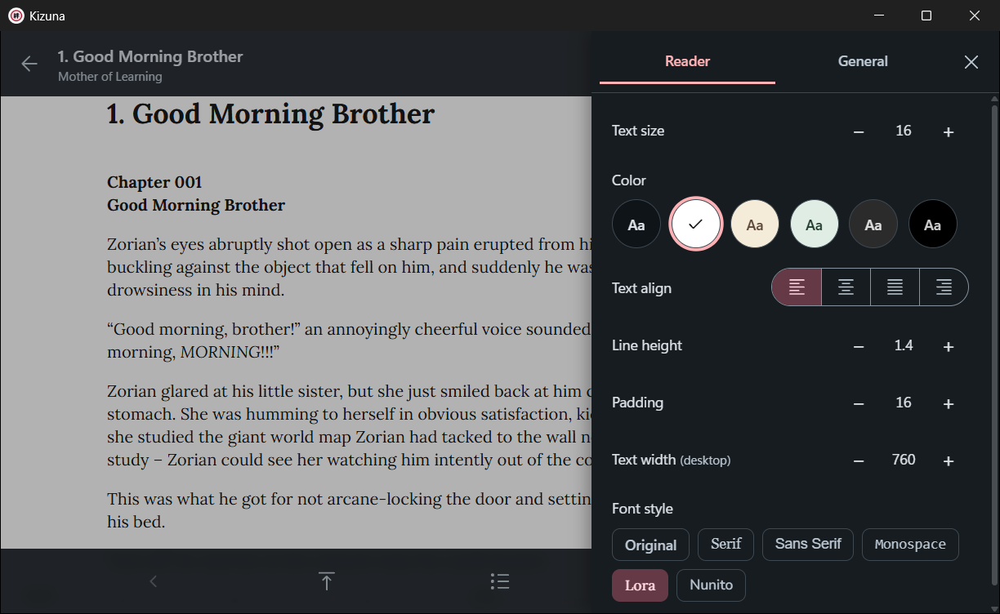</td>
  </tr>
  <tr>
    <td><b>Read in comfort</b>: Lora or Nunito, sepia, paper or night colours, and a text width you set.</td>
    <td><b>Make it yours</b>: text size, line height, padding, alignment and fonts, changed live.</td>
  </tr>
  <tr>
    <td>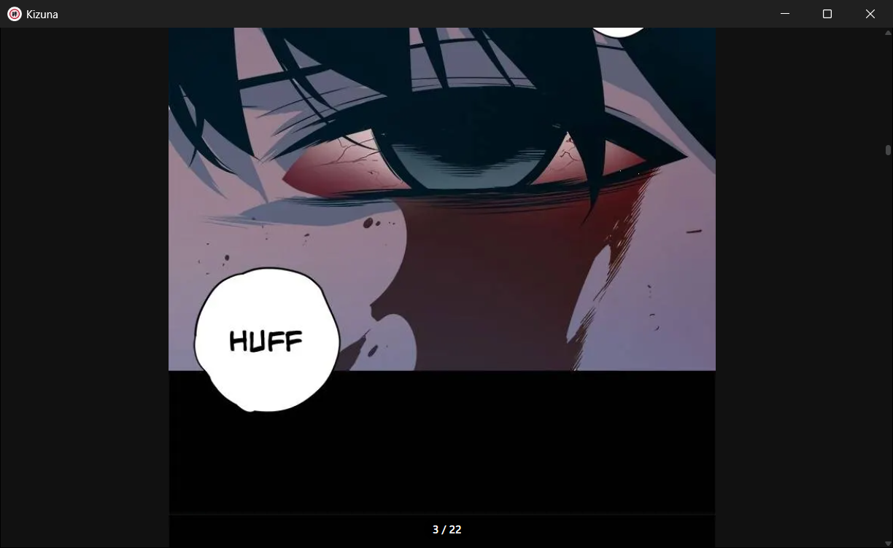</td>
    <td>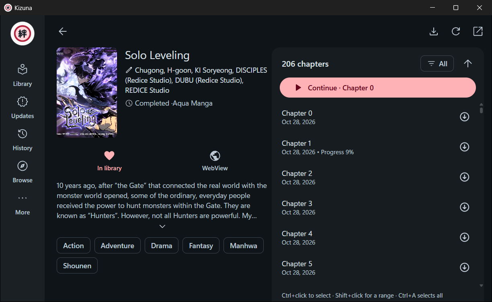</td>
  </tr>
  <tr>
    <td><b>Manga too</b>: a long-strip reader with a page counter, online or from your downloads.</td>
    <td><b>Every chapter in one place</b>: continue where you stopped, download chapters with one click.</td>
  </tr>
  <tr>
    <td>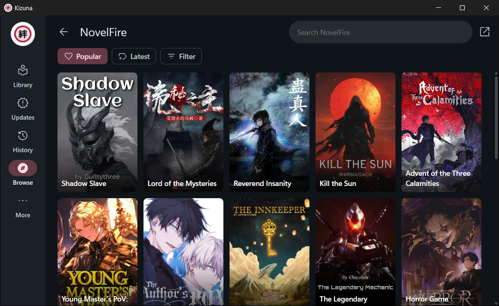</td>
    <td>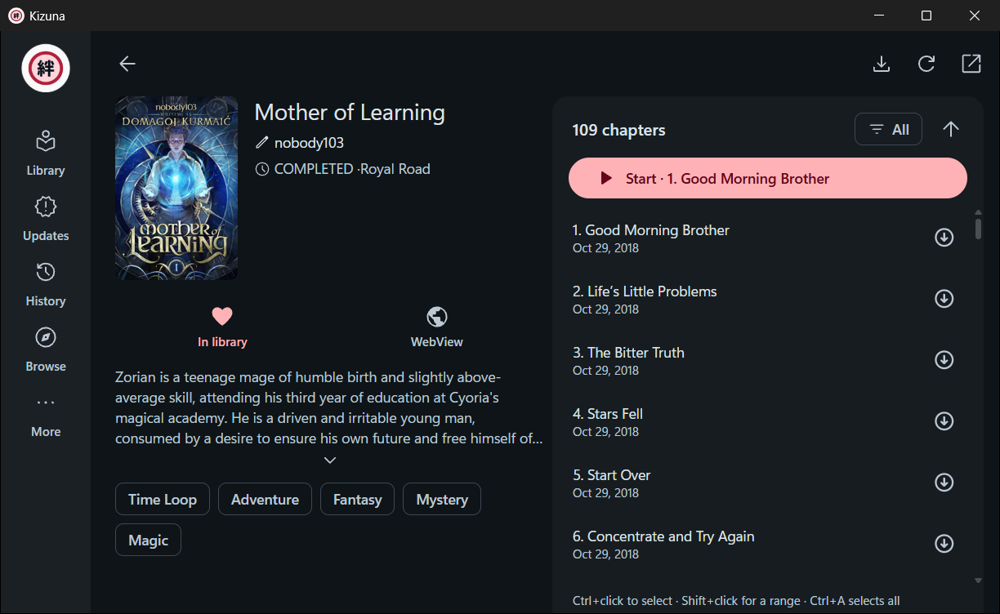</td>
  </tr>
  <tr>
    <td><b>Find your next read</b>: Popular, Latest, search and filters for every source.</td>
    <td><b>Know what you're getting</b>: cover, author, status, tags and the full chapter list.</td>
  </tr>
</table>

<div align="center">

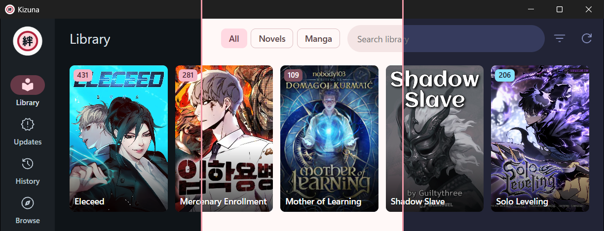

**One app, 15 themes.** Kizuna, Mihon, Catppuccin, Tokyo Night, Nord, Strawberry and more, in light, dark and pure black.

</div>

## Features

<div align="left">

**Reading**
* A native novel reader: font size and family (bundled Lora and Nunito), reading colours, line spacing,
  padding, column width, bionic reading and auto-scroll.
* A vertical seekbar and a battery, progress and clock strip.
* Keyboard controls: ← → for chapters, C for the chapter list, S for settings, F11 for fullscreen.
* A manga reader for Mihon extensions, with an optional manga engine that the app downloads for you
  (More → Enable manga).

**Library**
* Categories, sorting, unread badges and a downloaded-chapter badge.
* Check your whole library for new chapters, with History and Updates screens.
* Offline downloads with a download queue for novels and manga, saved under readable folder names in a
  location you choose.

**Sources**
* Novel sources from the Kizuna plugin list: NovelFire, WTR-LAB, Royal Road, Webnovel, Novel Phoenix,
  NovelPing, Azure Chronicles.
* Manga from any Mihon extension repo you add (no repos are built in).
* Sites behind a Cloudflare check open in a real browser window, where you solve the check yourself.
  The app never tries to get around it.

**App**
* First-run setup: pick a theme, choose where downloads go, then import a backup or start browsing.
* 15 themes in light, dark and pure black.
* Automatic updates.

</div>

## Coming from Kizuna on Android?

<div align="left">

Make a backup in the phone app, copy the `.tachibk` file to your PC, then open
**More → Library → Import backup from the phone app**. Your library, categories, read chapters,
bookmarks, history and extension repos come across. Importing again never loses progress, so you can
re-import whenever you like.

</div>

## Download

<div align="center">

<a href="https://github.com/ohimeee/Kizuna-Desktop/releases/latest"></a>

</div>

<div align="left">

On the [latest release](https://github.com/ohimeee/Kizuna-Desktop/releases/latest), pick one:

| File | Choose it when |
| --- | --- |
| `Kizuna_x.y.z_x64-setup.exe` | **Not sure? Take this one.** Installs for your user only, without admin rights, and updates itself. |
| `Kizuna_x.y.z_x64_en-US.msi` | You prefer an MSI package, for example to deploy it with your own tools. |

Requires Windows 10 or 11 (64-bit).

> [!NOTE]
> The installer isn't code-signed yet, so Windows SmartScreen may say *"Windows protected your PC"*
> the first time. Click **More info**, then **Run anyway**.

</div>

## Support

<div align="left">

Kizuna is free and always will be. If it makes your reading better, you can tip the developer on Ko-fi.
Nothing in the app changes or unlocks.

[](https://ko-fi.com/kizunaorg)

A ⭐ on GitHub helps too: it's how other readers find the app.

</div>

## Building from source

<details>
<summary>Requirements and commands</summary>

<div align="left">

You need Node.js 20 or later, Rust (stable, MSVC), and the Visual Studio C++ Build Tools.

```sh
npm install
npm run tauri dev     # run with hot reload
npm run tauri build   # build the installers
npm test              # frontend tests (from src-tauri/: cargo test --lib)
```

The manga extension host lives in `ext-host/` (Kotlin, built with Gradle: `.\gradlew.bat :host:fatJar`).

</div>

</details>

## Contributing

Pull requests are welcome. For major changes, please open an issue first to discuss what you would like to change.

## About the name

Kizuna (絆) means "bond" or "connection": one library that connects your phone and your PC.

### Credits

Kizuna Desktop's reader follows the [Kizuna](https://github.com/ohimeee/Kizuna) Android reader,
which builds on [Mihon](https://github.com/mihonapp/mihon) and patterns from
[LNReader](https://github.com/LNReader/lnreader). The manga add-on runs Mihon extensions using
[Suwayomi](https://github.com/Suwayomi/Suwayomi-Server)'s Android compatibility layer (MPL-2.0, see
[ext-host/NOTICE.md](./ext-host/NOTICE.md)). Thank you to all contributors of those projects.

### Disclaimer

<div align="left">

* **Kizuna hosts no content.** It is a reader: it shows what websites already publish, the same way a
  web browser does. No novels, manga, chapters or images are stored on or served by this project.
* **No affiliation with any site.** The developers are not affiliated with, endorsed by or connected to
  any of the websites or content providers that sources and extensions load from. All names, logos and
  trademarks belong to their owners.
* **Sources and extensions are third-party.** Novel plugins and manga extensions are made and maintained
  by other people. You choose which ones to add, and you are responsible for how you use them and for
  following the laws where you live.
* **Copyright questions go to the site.** Since Kizuna hosts nothing, it can't remove content. Please
  contact the website that publishes it.
* **Support the creators.** If you enjoy a series, read it on official platforms and buy the books when
  you can.

Covers and pages in the screenshots belong to their respective owners and are shown only to illustrate
the app.

</div>

### License

<pre>
Copyright © 2026 Kizuna Contributors

Licensed under the Apache License, Version 2.0 (the "License");
you may not use this file except in compliance with the License.
You may obtain a copy of the License at

http://www.apache.org/licenses/LICENSE-2.0

Unless required by applicable law or agreed to in writing, software
distributed under the License is distributed on an "AS IS" BASIS,
WITHOUT WARRANTIES OR CONDITIONS OF ANY KIND, either express or implied.
See the License for the specific language governing permissions and
limitations under the License.
</pre>

The bundled Lora and Nunito fonts are licensed under the SIL Open Font License. See
[docs/third-party-licenses/fonts](./docs/third-party-licenses/fonts).
